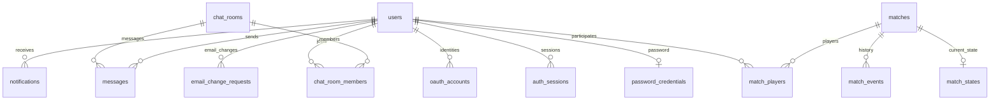

# DB全体設計の提案

[設計案一覧・相談事項](README.md) / [実装順・確認項目](implementation.md)

状態: **チーム相談前の提案**。既存の採用機能を見渡し、テーブルの関係と実装の境界を相談するための資料。SQL・Prisma定義・マイグレーションは未作成であり、以下のテーブル名・項目・制約は合意前の案とする。

根拠は [全体概要](../PROJECT_OVERVIEW.md) の §4・§6、[タスク一覧](../TASKS.md)、[担当表](../TASK_ASSIGNMENT.md)。登録・ログインのAPI案は [認証基盤の設計案](auth.md) を参照する。

## 今回提案したいこと

1. ユーザーを表す不変の `users.id` を、対局・フレンド・通知などから参照する。表示名とメールは変更できる属性として扱う。
2. 対局では、基本情報・参加者・現在の状態・確定した操作履歴を分けて考える。現在の状態と履歴は一緒に保存し、復帰と棋譜再生の両方に備える。
3. 全機能の関係を先に合意し、認証、対局、後続機能の順に詳細とマイグレーションを追加する。後続機能も今回の一覧に含める。
4. haruが全体のDB設計の初案を用意し、各機能の担当者が必要な情報・操作を確認する。各テーブルの保存処理を誰が書くかは別途合意する。

最初の打ち合わせでは、この4点と [相談事項](README.md#db全体の相談事項) を確認する。詳細な列の読み合わせは認証・対局から始める。

## 読み方と共通ルール

| 用語 | この資料での意味 |
|---|---|
| 主キー（PK） | その行を一意に識別する値。例: `users.id` |
| 外部キー（FK） | 参照先の行が存在することを保証する制約。例: 対局参加者の `user_id` が `users.id` を参照する。操作の権限は別に確認する |
| 一意制約（UNIQUE） | 同じ値や組み合わせの重複をDBで拒否する仕組み |
| インデックス | 必要な行を探すための索引。外部キーと役割が異なる |
| トランザクション | 複数の保存を、全部成功または全部取り消しにまとめる単位 |
| スナップショット | ある時点の状態を、そのまま復帰できる形で保存したもの |

- 独立したデータのIDにはPostgreSQLの `uuid` 型を候補とする。認証では現在のPostgreSQL 16に合わせ、内蔵の `gen_random_uuid()` によるUUIDv4を初案とした。参照する側も同じ型に揃える。組み合わせで識別できる中間テーブルには複合主キーを使える。
- 日時は `timestamptz`、回数・順番・残り時間は整数を基本にする。時間の単位は列名にも明示する。
- DBの列名は `snake_case`、APIは `camelCase` を候補とする。Prismaの対応づけを一度定める。
- 検索・並べ替え・関係づけに使う情報は通常の列に置く。盤面などのまとまった構造には `JSONB` を使い、構造と形式のバージョンをBEで検証する。
- 主キー・一意制約により作られる索引と重複する索引は追加しない。外部キー側の索引は検索・結合・削除確認に応じて設計する。PostgreSQLは外部キーを作るだけでは参照元の索引を自動作成しない。[制約の仕様](https://www.postgresql.org/docs/current/ddl-constraints.html)
- DBモデルをそのままAPIに公開しない。公開プロフィール、本人情報、認証情報を区別する。

## 全機能のテーブル候補

「導入」は実装する時期の案であり、採用機能を対象から外す意味ではない。後続領域は関係までを今回の合意対象にし、全列の確定は各担当との相談後に行う。表の矢印はデータ同士のつながりを示す。外部キーを置く列は詳細設計で明記する。

| 領域 | テーブル・関係の候補 | 保存する情報と設計上の論点 | 導入 |
|---|---|---|---|
| 認証 | `users` → `password_credentials` / `auth_sessions`。登録時のメール確認を採用する場合は `email_verification_requests` を追加 | ユーザー、パスワードハッシュ、端末ごとのログイン・失効。初期範囲は認証案のA・Bから合意する | P0 |
| プロフィール | `users.avatar_file_id` → `files` | 表示名・自己紹介は初案では `users`。画像はファイルIDで参照。公開項目と編集権限を決める | P2 |
| メール変更・外部ログイン | `users` → `email_change_requests` / `oauth_accounts` | 変更待ちメールと確認状態。OAuthはプロバイダーのユーザー識別子を保存 | 変更機能の時期は相談、OAuthはP2 |
| フレンド・ブロック | `friendships` / `user_blocks` がそれぞれ2人の `users` を参照 | 申請者・承認状態、方向のあるブロック。自己申請と重複を防ぐ | P2–P3 |
| 対局・観戦・カスタマイズ・AI対戦 | `matches` → `match_players` / `match_states` / `match_events` | 参加者、設定、勝敗、現在の状態、操作履歴。観戦権限とAI参加者の拡張も下記で整理 | P1から段階導入、拡張はP3 |
| 対局統計・検索 | `users` → `ratings` / `rating_events`、`rating_events` → `matches` | 現在値と計算履歴。モード別の集計、千日手・再勝負の扱い、結果の二重反映を防ぐ | P3 |
| 大会 | `tournaments` → `tournament_entries` / `tournament_matches`、`matches` → `tournament_matches` | 参加登録、組み合わせ、進行。大会の1枠に再勝負を含む複数の実対局を関連づける | P3 |
| チャット | `chat_rooms` → `chat_room_members` / `messages`、`messages` → `message_attachments` → `files` | 参加者、送信者、本文、既読位置、添付。部屋の参加権限とブロックを確認 | P2–P3 |
| 対戦招待 | `match_invitations` → 招待元・招待先の `users`、成立後の `matches` | 期限、承認・拒否・取消状態。同時承認で対局を二重作成しない | P2–P3 |
| 通知 | `users` → `notifications` | 宛先、種類、発生元、既読日時。フレンド申請・招待などの本体の状態を通知だけで管理しない | P2 |
| 権限・組織 | `roles` ← `user_roles` → `users`、`organizations` ← `org_members` → `users` | アプリ全体のロールと組織内の役割を分ける。同一組織への二重加入を防ぐ | P4 |
| 実績・XP | `achievements` ← `user_achievements` → `users`、`users` → `xp_events` | 実績定義・獲得・加算履歴。ランキングは集計から開始し、必要なら集計結果を保存 | P3 |
| ファイル・棋譜 | `users` → `files` / `kifu_records`、`kifu_records` → `files`、任意で `matches` | 所有者、保存先、種類、サイズ、公開範囲、棋譜の由来。インポートした棋譜を公式対局の戦績に混ぜない | P2のアバターから段階導入、棋譜はP4 |
| 共同検討盤 | `review_boards` → `review_members` / `review_nodes`、任意で `kifu_records` | 参加者・編集権限、局面と分岐。ノードは親ノードを参照し、公式対局を変更しない | P4 |
| 公開API | `users` → `api_keys` | キーのハッシュ、権限範囲、有効期限、失効日時。キーの平文は保存しない | P4 |
| 活動分析 | `users` → `activity_events` | 必要な操作の種類・発生日時。対局統計等と組み合わせてダッシュボードを作る。秘密情報を記録しない | P4 |
| データ開示・削除 | `users` → `data_requests` | 開示・削除・エクスポート要求、本人確認、処理状態、期限付き成果物 | P5 |
| チェーン記録 | `tournaments` → `chain_records` | 確定結果の版、送信状態、トランザクション識別子。再試行・失敗時の扱いを決める | P5 |
| 保存後の通知・外部処理 | `outbox_events`（必要となる段階で追加） | DB更新と一緒に「後で実行する処理」を保存する案。通知・統計・チェーン送信の取りこぼしと重複処理に対応 | 各連携の導入時 |

後続領域の接続で先に確認する制約は、`oauth_accounts(provider, provider_subject)`、`org_members(organization_id, user_id)`、`tournament_entries(tournament_id, user_id)`、`chat_room_members(room_id, user_id)` などの一意性。プロバイダー識別には発行元・テナントの範囲も含める。

フレンド関係は2人のIDを一定の順序で並べて一意にし、申請の方向は申請者IDで持つ案。ブロックは `(blocker_id, blocked_id)` の方向を維持する。採用する拒否・再申請・解除の仕様と合わせて確定する。

オンライン状態、入力中表示、Socket接続IDは短時間で変わる情報であり、そのまま恒久保存するテーブルは今作らない。観戦も当初は読み取り権限と配信先の管理で扱い、観戦履歴が必要になった時点で保存要件を決める。

## 中心となる関係図

まず人間同士の対局を示す。1人は複数の対局に参加でき、1対局は待機中に1人、開始時には黒・白の2人を持つ。AI対戦時の参加者表現は後述の相談事項とする。



図は主要な関係の抜粋。開始済みの対局に参加者2人と状態1件が必ずあることは、外部キーだけでは保証されない。開始処理のトランザクションで確認し、開始後の参加者変更を禁止する。

## ユーザー・認証の詳細案

| テーブル | 主な項目 | 制約・理由 |
|---|---|---|
| `users` | `id`、`email`、`email_verified_at`、`display_name`、作成・更新日時 | `id` が主キー。メール登録ではメール必須・一意。表示名は必須・重複可。確認済み日時は未確認なら `null` |
| `password_credentials` | `user_id`、`password_hash`、更新日時 | `user_id` が主キー兼外部キー。1人につき最大1件。パスワードを持たないOAuthユーザーへの拡張を妨げない |
| `auth_sessions` | `id`、`user_id`、`expires_at`、`revoked_at`、作成日時 | 1人に複数のセッション。JWTの署名・期限に加え、セッションの失効状態とユーザーの対応も検証する |
| `email_change_requests` | `id`、`user_id`、変更前・変更希望のメール、確認用トークンのハッシュ、確認日時、有効期限、完了・取消日時 | 確認中は `users.email` を上書きしない。旧・新メール確認を採用する場合はトークンと確認日時をそれぞれ持つ |
| `oauth_accounts` | `id`、`user_id`、`provider`、`provider_subject`、作成日時 | プロバイダー内の識別子の組を一意にする。メール一致だけで既存アカウントへ自動連結しない |

初期登録では `users`・`password_credentials`・ログインさせる場合の `auth_sessions` を一括作成する。認証3テーブルの列・型・削除時動作、メールの正規化、文字数、ログイン期限の具体案は [認証基盤の設計案](auth.md) を正本とする。登録時のメール確認は同資料のA・B案からチームで合意する。

OAuthでメールを取得できない利用者を受け入れるかは未決定。受け入れる場合は `users.email` の必須条件とAPIの `Viewer.email: String!` を一緒に見直す。パスワードだけを任意にしても、この論点は解決しない。

### メールを変更しても同じユーザーとして扱う

```text
変更前: users(id=u123, email=old@example.com)
変更後: users(id=u123, email=new@example.com)

対局参加者: match_players(user_id=u123)  ← 参照先のIDは変わらない
```

上のIDは説明用。JWTも本人を不変のユーザーIDで表し、メールを対局・フレンドの参照キーにしない。

変更機能を提供する際の初案は次のとおり。

1. ログイン中の本人が現在のパスワード等で再認証し、新しいメールを申請する。
2. 変更待ちとして保存し、期限付き・一度だけ使える確認を行う。MFAを持たない初期構成では、旧・新両方のメールで確認する案とする。
3. 確認完了時に申請の期限・取消・変更前メールとの一致を再確認し、メールの一意制約の下で更新する。申請完了も同じトランザクションにする。
4. 同時申請・再送で古い申請が後から有効にならないよう失効させる。メール変更時のセッション失効と再ログインはFEの画面遷移も含めて合意する。

これは [OWASPのメール変更の指針](https://cheatsheetseries.owasp.org/cheatsheets/Authentication_Cheat_Sheet.html#changing-a-users-registered-email-address) を参考にした提案。旧メールが使えない場合の復旧とOAuth利用者の再認証は別のフローとして決める。メール送信基盤と確認画面ができるまでは、メール変更APIを提供しない選択も可能。

## 対局の詳細案

### 保存対象を4つに分ける

| テーブル | 主な項目 | 制約・理由 |
|---|---|---|
| `matches` | `id`、進行状態、設定、ルール・データ形式の版、開始時の状態、勝者の色・終局理由、開始・終了日時、任意の再戦元ID・大会枠ID | 対局の基本情報。状態は `waiting / active / finished / cancelled` を候補とし、エンジン内の配置・対局フェーズとは区別する |
| `match_players` | `match_id`、`side`、`user_id`、参加日時 | `side` は黒・白に限定し、`(match_id, side)` を主キー、`(match_id, user_id)` を一意にする。各色1人、同じ人の二重参加を制限。両IDは外部キー |
| `match_states` | `match_id`、`version`、`state`、両者の残り時間、時計の基準日時、`clock_deadline_at`、更新日時 | `match_id` が主キー兼外部キー。開始時に1件作成。`state` は現在の完全な `GameState` をJSONBで保存。時計の期限は `timestamptz` で、初期案では対局中に必須、終局時に `null` |
| `match_events` | `match_id`、`seq`、`request_id`、操作の種類・内容、実行元、任意の実行ユーザーID、確定日時、操作後の時計情報 | `(match_id, seq)` を主キー、`(match_id, request_id)` を一意にする。受理した状態変更を順番に保存し、再送による二重適用を防ぐ |

`matches` の設定は作成時の案を持ち、開始時に確定する。開始時の状態・設定・ルールの版と順番付きの操作から棋譜を再現する。ルールを変更した際に過去の対局を新ルールで再解釈しないよう、互換性の扱いも決める。

待機中は開始時の状態・開始日時・結果を未設定にできる。開始後は必要な情報を必須にし、終了時には終局理由を保存する。勝者がいない引き分けと未終了は、進行状態・終局理由で区別する。連番・残り時間の非負制約や開始・終了日時の前後関係も詳細定義に含める。

既存の [全体概要の初期案](../PROJECT_OVERVIEW.md) は `matches.moves(JSONB)` に履歴をまとめる形。本提案では再送の一意制約や順番ごとの取得を扱いやすくするため、履歴を `match_events` に分ける。テーブルと整合性管理が増えるため、規模と実装負担をkoyonと確認する。履歴を丸ごとJSONBで保存する案も比較対象に残す。

### 盤面・現在状態・棋譜の違い

- `GameState.board` は盤上の駒。これだけでは持ち駒・手番・千日手の判定情報が不足する。
- `GameState` はゲームを続行するための状態。`hands`、`turn`、`positionCounts` なども含む。`positionCounts` は局面の出現回数であり、過去の着手を順番に記録した棋譜ではない。
- 棋譜には初期状態と順番付きの操作を保存する。初期配置、配置完了、投了、サーバーが確定した時間切れなども再現できるようにする。
- 持ち時間・切断時の扱いはエンジン外の情報。時計の基準日時・残り時間・絶対期限を復帰可能な形にする。初期案はサーバー停止中も時計が進む方式とし、停止中の時計停止を求める場合は停止期間の確定・期限補正を別途合意する。

既存エンジンはJSONでの保存を想定している。復元した状態は `stateError` で検証してから使う。ただし、この検証だけで過去の手順が正しいと証明されるわけではない。[軍儀ルール §11・§12](../GUNGI_RULES.md)、[GameState / Move定義](../../packages/gungi-engine/src/types.ts)

### 一手を受け取ってから保存する流れ

1. Authで本人を確認する。要求には対局ID、操作、FEが見ている版番号、再送の識別用 `request_id` を付ける案。
2. 短いトランザクションを開始し、対象の `matches` 行をロックする。同じ対局を変更する参加・開始・着手・投了・時間切れ処理は、共通のロック規約に従う。
3. 最新の参加者を読み、要求者を確認する。既に受理済みの `request_id` なら、同じ実行者・同じ要求内容であることを確かめて前の結果を返す。既に終局していても受理済みの要求は再実行しない。異なる要求でのID再利用は拒否する。
4. 新しい要求では進行状態・操作の権限・版番号・現在状態と入力を確認する。黒・白は認証済みユーザーから割り当てる。古い版への操作は拒否し、最新状態の取得を促す。
5. 着手をエンジンへ渡す前に、同じロック内で最新の時計情報とサーバー時刻から残り時間を確認する。期限に達していれば要求された着手は適用せず、サーバーが時間切れの操作を作って終局させる。期限前なら要求された着手をエンジンで検証・適用する。
6. 受理した着手または時間切れについて、イベント追加・現在状態更新・時計更新・終局結果をまとめて確定する。どれかの保存に失敗したらすべて取り消す。時間切れを検出した場合も、終局を保存してから着手不受理と最新状態を返し、着手を拒否することを理由に終局の保存を取り消さない。
7. DB確定後に応答・配信する。配信に失敗しても確定済みの状態変更は取り消さず、再送確認と下記の再同期でDBの状態へ揃える。

時計の初期案は処理時刻基準とする。ロックを取得して最新状態を読んだ時点でサーバー時刻を取得し、その時刻で期限判定と時計更新を行う。ロック待ち前の時刻・トランザクション開始時刻・クライアント申告時刻は使わない。期限と同時刻なら時間切れとする。この案では通信・ロック待ちの時間も持ち時間に含まれるため、対局担当と合意する。時計を動かすフェーズ・側は対局設定に従う。

時間切れ用のタイマー処理は、クライアントの操作受付とは別のサーバー内部処理から、同じ対局行のロック・最新状態と時計の確認・終局保存を行う。着手が届かない場合も期限切れを確定し、古い手番のタイマーが遅れて届いた場合は現在の時計で判定し直す。既に終局済みなら更新しない。タイマー通知だけを根拠に終局させず、着手側と合わせて終局イベントを1回だけ保存する。サーバー内部の時間切れ操作をクライアントが直接指定することは許可しない。

### 再起動後の時計復元と終局の保証

初期の推奨案は、両者に有限・正の持ち時間を必須とし、配置フェーズから終局まで時計を動かす。加算・無制限の停止は設けず、フェーズ遷移でも残り時間をリセットしない。進行中は必ずどちらかの時計が進むため、操作し続けても両者の持ち時間の合計以内で時間切れに達する。具体的な持ち時間はカスタマイズとFEの要件に合わせて合意する。

「持ち時間なし」はこの初期案では開始できない。後から提供する場合は、操作で延長できない対局全体の期限と、期限到達時の結果・エンジンへの反映方法まで合意してから追加する。無操作タイムアウトや切断期限だけでは、両者が操作し続ける対局を有限にできない。合意前に時間無制限モードを公開しない。[軍儀ルール §11.6](../GUNGI_RULES.md#116-時間切れ切断)

1. 開始・着手・フェーズ遷移のたびに、時計の基準日時と残り時間から次の `clock_deadline_at` を計算し、状態・イベントと同じトランザクションで保存する。終局時は期限を `null` にする。プロセス内タイマーは通知を早める補助であり、DBの保存期限を正本とする。
2. 起動時に `active` な対局を少量ずつ走査し、各対局を共通の行ロックで読み直す。既に期限切れなら時間切れを1回だけ保存し、期限前なら保存期限でタイマーを張る。復元時の現在時刻へ残り時間を足し直して期限を延ばさない。
3. 起動後も1秒ごとを初案として、期限に達した行を定期走査する。タイマーの消失・設定失敗・DB障害からの復帰もこの走査で回収する。DBへ接続できない間は対局更新を受け付けず、復旧後に期限を再確認してから更新する。
4. 起動処理・定期走査・着手が競合しても、同じ行ロック内で最新の進行状態・時計を確認し、既に終局した対局を二重更新しない。保存途中で失敗した処理は取り消し、次回走査で再試行する。1回の走査全体を長いトランザクションにしない。

時計・サーバー時刻は全プロセスでUTCと時刻同期を前提にする。切断専用の猶予を追加する場合も、対象の側と期限をDBへ保存し、復元・定期走査・再接続の競合を同じ規約で扱う。現段階では切断中も持ち時間が進むため、切断猶予を理由に時計を止めない。これらの案は対局実装前にkoyon・018re18と合意する。

### 保存後の配信と再同期

再接続時だけでなく、対局画面を開いている間は定期的にサーバーの版番号を確認し、画面が再び表示された際にも再同期する案とする。相手への配信だけが失われ、その後に着手も切断も起きない場合にも、状態のずれを検出するためである。確認間隔・負荷・バックグラウンド時の扱いはkoyonとFE担当で合意する。版番号が欠ける・食い違う場合は閲覧権限を確認して最新状態を取得し、遅れて届いた古い版で新しい表示を上書きしない。Socket.IOの標準設定だけでは失われたサーバー配信の再送は保証されないため、アプリ側の再同期を設計する。[Socket.IOの配信保証](https://socket.io/docs/v4/delivery-guarantees/)

`version` は開始時を0とし、状態変更を受理するたびに1増やして `match_events.seq` と対応させる。エンジンの `ply` と同じ値であるとは仮定しない。再送時の要求比較・元の応答を復元する情報は、通信契約の確定時に定義する。サーバーが作る時間切れ等の要求にも識別子を付け、再試行で二重適用しない。

行ロックは同じ対局の同時更新を順番に処理するための案。外部通信・メール送信・対戦相手の入力待ちはトランザクション内に置かない。[PostgreSQLの行ロック](https://www.postgresql.org/docs/current/explicit-locking.html#LOCKING-ROWS)

投了は手番に関係なく許可されるため、すべての要求に同じ手番チェックをかけない。時間切れはサーバー判定、合意引き分けは両者の合意確認を経る。引き分けの提案・承諾、切断期限、時計の停止など、エンジン外の状態変更をどのイベントとして保存するかは対局担当と詰める。

勝敗など `matches` に複写する検索用情報は、エンジン結果から同じ処理で更新する。統計・レーティングは確定結果から作り、インポート棋譜や検討盤の結果を加算しない。後続処理は対局ID等の一意な処理キーで二重反映を防ぐ。

### 先に備えておく拡張

- 千日手後の再勝負は新しい対局として作り、`rematch_of_id` で元の対局へ関連づける案。戦績・レーティング上の扱いは018re18と確認する。
- AI対戦では人間のアカウントを必須にしない参加者表現が必要。`participant_kind` と、人間の `user_id` または対戦プログラムの設定を持つ拡張案をkoyonに確認する。現在の図・制約はPvPを対象にしている。
- 大会の1枠と実対局を分け、千日手の再勝負で大会の組み合わせが増えないようにする。
- 観戦は対局の閲覧権限を別に確認する。非参加者でも観戦を許可できる一方、着手は許可しない。

## 取得したい情報から索引を考える

以下は候補。実際のSQLと実行計画で確認し、同じ先頭列を持つ既存の主キー・一意索引も考慮して確定する。

| 取得したい情報 | 索引の候補・既存制約 |
|---|---|
| メールでユーザーを探す | 正規化ルールに従った `users.email` の一意索引 |
| 本人のセッションを一覧・失効する | `auth_sessions(user_id)`。期限切れ削除用の `auth_sessions(expires_at)` と合わせ、認証案の初期索引とする |
| 対局の参加者・現在状態・操作履歴を読む | `match_players(match_id, side)`、`match_states(match_id)`、`match_events(match_id, seq)` の主キー |
| 時間切れの候補を回収する | `match_states(clock_deadline_at)` の非NULL行の部分索引。起動時の対局走査は `matches(status, id)` を候補にする。取得後は行ロック内で期限と進行状態を再確認 |
| 自分の対局を探す | `match_players(user_id, match_id)`。日時・結果の並べ替えは `matches` との結合で確認し、必要な追加索引を判断 |
| チャットの履歴を順に読む | `messages(room_id, created_at, id)`。同時刻でもIDで順番を安定させる |
| 本人の通知を新しい順に読む | `notifications(recipient_id, created_at, id)`。未読絞り込みの索引は利用状況で追加 |

通知の対象・添付ファイル・検討盤へのリンクを知っているだけでは閲覧権限にならない。読み取り時にも対象の権限を確認する。複数種類の対象を指す通知の表現は、型別の外部キー等とJSONメタデータの使い分けを詳細設計で決める。

## 変更・削除と保持の境界

表示名・メールの更新では `users.id` を維持する。対戦履歴で「現在の表示名」と「当時の表示名」のどちらを見せるかはFEと決める。当時の名前を保存する場合も、本人との関係にはIDを使う。

ユーザー削除では、認証情報の破棄、対局・大会結果の保持、メッセージ・添付ファイルの削除または匿名化を分けて合意する。ログイン停止や `deleted_at` の追加だけで、データ削除が完了したとは扱わない。

現段階では対局などへ無条件の連鎖削除を設定する方針を置かない。外部キーの削除時動作、匿名化後の参加者表現、保存期間は各領域の実装前に決める。チェーンへ記録する情報についても、メールなどの個人情報を含める設計は置かない。

## FEと先に合わせる契約

| 画面・操作 | FEへ渡すもの | 相談すること |
|---|---|---|
| 登録・ログイン | `signUp` / `signIn` / `me` / `signOut`、本人情報型、エラー例 | 入力項目、文字数、メール確認、Cookie、期限切れ時の遷移 |
| プロフィール | 公開プロフィール型、本人用編集入力 | 一意のユーザー名が必要か、自己紹介・アバター、未指定と `null` の違い |
| メール変更 | 申請・確認・取消と処理状態 | 確認中の表示、旧メールが使えない場合、再ログイン |
| 対局 | 対局ID、自分の色、状態、版番号、時計、操作結果 | Socket.IOとGraphQLの分担、再送ID、競合時・再接続時の同期 |
| 対戦履歴 | 相手・結果・日時・ページ情報、棋譜取得 | 名前の表示、フィルタ、再勝負の表示、公開範囲 |

対局の操作名・GraphQL型やイベント形式はkoyonと合意後に生成する。DBのJSONB列が、そのままGraphQLの無検証なJSON入力になるわけではない。エンジンの型を活用し、外部入力はBEで検証する。

## 担当の境界案

| 内容 | 現在の資料から分かる範囲 | 今回の相談案 |
|---|---|---|
| DB・GraphQL・認証基盤 | haruの初期担当 | haruが全体の関係図・共通規約・認証実装を用意する |
| 対局・ゲームエンジン・リアルタイム | koyonの担当 | haruがDB案を提示し、koyonが保存対象と対局処理を確認する。Prisma定義・保存処理の実装者を合意する |
| 統計・大会・組織・公開API | 018re18の担当 | 各機能の検索・更新・削除要件を確認し、共通のユーザー・対局IDで接続する |
| プロフィール・通知のFE | ryu-lionの担当 | 画面に必要な項目・状態・エラーを確認する |
| チャット・フレンド周辺 | koyon / haru / ryu-lionに関連する記述がある | 基本チャット、フレンドAPI、ブロック・招待の保存処理を具体的に分担する |

認証・認可・DB制約はすべてBE側の設計に関わるが、BEを1人だけが実装するという意味ではない。認証基盤は検証済みのユーザーIDを渡し、各機能がその操作の権限を確認する。
